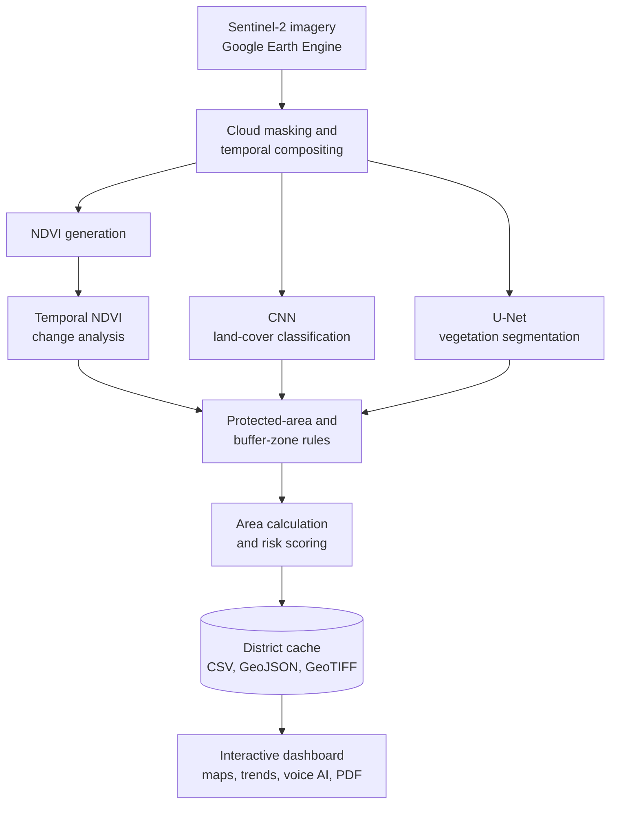

<div align="center">

# Geo Vision Plan-Net

### Smart Green Cover Detection System

*AI-assisted geospatial intelligence for vegetation monitoring, deforestation analytics and environmental risk screening*


</div>

---

## What is Geo Vision Plan-Net?

Cities spread, forests thin out and farmland gives way to concrete, yet no team can walk every hectare to see what has changed. **Geo Vision Plan-Net** does the watching from orbit, turning satellite imagery into evidence that planners, researchers and forest officials can act on.

It draws on **Sentinel-2 imagery** through **Google Earth Engine**, measures how vegetation has changed from year to year using **NDVI**, and adds two deep-learning models: a **CNN** that recognizes what kind of land a patch of ground is, and a **U-Net** that traces vegetation at the level of individual pixels. Spatial rules then check every detected change against protected areas and their buffer zones. The result is an interactive dashboard with district maps, multi-year trends, side-by-side comparisons, one-click PDF reports and a **voice assistant that answers in your own language**.

In short, it answers three questions for any district: **what changed, where it changed, and how serious it is.**

> **Design principle.** Every signal has its own job. NDVI gives the interpretable change signal, the CNN adds land-cover context, the U-Net draws fine vegetation boundaries, and the rule engine turns it all into screening evidence. No single model is asked to do everything.

---

## Key Features

| Capability | Description |
|---|---|
| Satellite data pipeline | Cloud-masked Sentinel-2 composites processed on Google Earth Engine |
| NDVI change detection | Vegetation loss, gain and severe-loss masks between study periods |
| CNN land-cover classification | Ten-class patch classification with confidence scores (EuroSAT) |
| U-Net vegetation segmentation | Pixel-level vegetation masks from RGB imagery |
| Rule-based risk screening | Protected-area encroachment, 500 m buffer-zone violations and severe-loss flags |
| Interactive GIS map | Violation polygons and NDVI heatmap with dark and light themes |
| Multi-year trend analytics | Loss, gain and flagged-violation trends from 2017 to 2026 |
| District comparison | Side-by-side comparison of any two districts across all metrics |
| GeoAI voice assistant | Voice and text queries in multiple Indian languages |
| Automated reporting | One-click PDF export of the executive summary |
| Cache-driven performance | Pre-computed district results for instant dashboard response |

---

## Dashboard

### Executive Overview

Key indicators for vegetation loss, vegetation gain, protected-area encroachment, buffer-zone violations, severe loss and total flagged area, together with an overall risk level out of 100 and an automatically generated written summary.

### GIS Violation Map and NDVI Heatmap

Flagged violation polygons are rendered on an interactive Leaflet map alongside an NDVI heatmap panel, showing where change occurred and how intense it was.

### Trend Analytics

Vegetation loss and gain over successive study periods, together with flagged violations per period.

### District Comparison

Any two districts can be compared on risk score, vegetation loss, vegetation gain, protected-area encroachment and total flagged violations.

### Recommended Conservation Actions

Each district summary is accompanied by suggested actions for field teams and planners.

### GeoAI Multi-Language Voice Assistant

Users can query metrics, switch districts and request reports by voice or text in their preferred language. Sessions can be run in languages such as Telugu and Kannada.

---

## System Architecture

The workflow follows nine stages: region selection, satellite data acquisition and cloud masking, temporal compositing and NDVI generation, CNN land-cover classification, U-Net vegetation segmentation, temporal NDVI differencing, protected-area and buffer-zone overlay, rule-based risk screening with area calculation, and cache-driven GIS visualization and reporting.



### Vegetation Change Detection

```
NDVI  = (NIR - Red) / (NIR + Red)
dNDVI = NDVI(t2) - NDVI(t1)
```

A negative change in NDVI indicates a reduction in the vegetation signal, and a positive change indicates an increase. Configurable thresholds convert the difference image into loss, gain and severe-loss masks. Affected area is obtained from pixel area and reported in hectares.

### Default Analysis Parameters

| Parameter | Value | Description |
|---|---|---|
| Satellite collection | `COPERNICUS/S2_SR_HARMONIZED` | Sentinel-2 surface reflectance |
| Maximum cloud cover | 20 % | Scenes above this threshold are excluded |
| Loss threshold | dNDVI < -0.15 | Classified as vegetation loss |
| Gain threshold | dNDVI > +0.15 | Classified as vegetation gain |
| Severe-loss threshold | dNDVI < -0.30 | Rule C |
| Buffer distance | 500 m | No-encroachment zone around protected areas |
| Protected-area data | WDPA polygons | World Database on Protected Areas |

### Screening Rules

| Rule | Condition |
|---|---|
| A. Protected-area encroachment | Vegetation loss within a protected area |
| B. Buffer-zone violation | Vegetation loss within the 500 m buffer, outside the protected area |
| C. Severe loss | dNDVI below -0.30 anywhere in the region |

The rule engine is a screening and decision-support component. It does not constitute legal adjudication.

---

## Deep Learning Models

### CNN: Land-Cover Classification

- **Input:** 64 x 64 x 3 RGB patches from the EuroSAT Sentinel-2 benchmark
- **Architecture:** four convolutional stages (32, 64, 128 and 256 filters) with batch normalization and max-pooling, followed by global average pooling, a 128-unit dense layer, dropout of 0.4 and a ten-class softmax output
- **Training:** Adam optimizer, sparse categorical cross-entropy, data augmentation

### U-Net: Vegetation Segmentation

- **Input and output:** 128 x 128 x 3 RGB patches at 10 m resolution, producing a per-pixel vegetation probability mask
- **Architecture:** encoder blocks (32, 64 and 128 filters), a 256-filter bottleneck, a decoder with skip connections and a 1 x 1 sigmoid output layer
- **Training:** weakly supervised. Pixels with NDVI above 0.3 form the pseudo-labels, and the objective combines binary cross-entropy and Dice loss

---

## Results

### CNN on the EuroSAT Test Set (5,400 samples)

| Metric | Value |
|---|---|
| Test accuracy | **93.46 %** |
| Test loss | 0.1899 |
| Macro precision / recall / F1-score | 0.94 / 0.93 / 0.94 |

<details>
<summary>Class-wise performance</summary>

| Class | Precision | Recall | F1-score | Support |
|---|---|---|---|---|
| Annual Crop | 0.99 | 0.89 | 0.93 | 596 |
| Forest | 0.97 | 0.99 | 0.98 | 608 |
| Herbaceous Vegetation | 0.92 | 0.90 | 0.91 | 573 |
| Highway | 0.96 | 0.92 | 0.94 | 496 |
| Industrial Buildings | 0.99 | 0.81 | 0.89 | 501 |
| Pasture | 0.94 | 0.96 | 0.95 | 396 |
| Permanent Crop | 0.91 | 0.94 | 0.92 | 538 |
| Residential Buildings | 0.88 | 1.00 | 0.93 | 554 |
| River | 0.91 | 0.96 | 0.94 | 529 |
| SeaLake | 0.99 | 0.97 | 0.98 | 609 |

</details>

### U-Net Vegetation Segmentation (Validation)

| Metric | Value |
|---|---|
| Dice coefficient | **0.9003** |
| Intersection over Union (IoU) | **0.8725** |
| Pixel accuracy | 0.9162 |

### Example District Outputs

The figures below are application outputs presented for demonstration.

| | Bengaluru Urban, Karnataka | Kamrup, Assam |
|---|---|---|
| Study period | 2017 - 2026 | 2017 - 2026 |
| Vegetation loss | 23,386.3 ha | 27,914.2 ha |
| Vegetation gain | 29,945.9 ha | 40,013.1 ha |
| Total flagged violations | 6,694.6 ha | 5,849.9 ha |
| Risk score | 68 / 100 | 60 / 100 |

### Limitations

- The CNN accuracy of 93.46 % is measured on the EuroSAT benchmark. It demonstrates strong patch-level recognition under benchmark conditions and does not establish performance across all geographic regions.
- The U-Net Dice and IoU values measure agreement with NDVI-derived pseudo-labels rather than independently annotated ground truth. They show that the model can reproduce the NDVI vegetation pattern from RGB imagery, not independent real-world segmentation accuracy.
- The district-level outputs are demonstration results.

Planned work to address these points is described under [Future Scope](#future-scope).

---

## Engineering Highlights

- **Cache-first dashboard.** `build_cache.py` pre-computes every district once. The live application reads cached files only, so no Earth Engine computation is needed per interaction.
- **Grid-cell statistics.** Large districts are divided into cells of roughly 500 sq km, processed in parallel and aggregated. This keeps each request within the Earth Engine interactive compute limit.
- **Adaptive GeoTIFF export.** The NDVI change map selects a resolution that fits the direct-download size limit, with automatic fallback to coarser scales.
- **Automatic retry.** Time-outs and memory errors are retried without manual intervention.

---

## Project Structure

```
geo-vision-plan-net/
├── app.py                  # Dashboard server (reads the cache only)
├── analysis_pipeline.py    # Earth Engine NDVI and rule-engine pipeline
├── build_cache.py          # Builds cache/<district>/ for every district
├── js/
│   └── map.js              # Leaflet GIS map renderer
├── cache/
│   └── <district_slug>/
│       ├── violation_summary.csv
│       ├── violation_trend.csv
│       ├── violation_zones.geojson
│       ├── ndvi_change_map.tif
│       └── metadata.json
└── requirements.txt
```

---

## Getting Started

### 1. Clone and install

```bash
git clone https://github.com/<your-username>/geo-vision-plan-net.git
cd geo-vision-plan-net

python -m venv venv
venv\Scripts\activate          # Windows
# source venv/bin/activate     # macOS / Linux

pip install -r requirements.txt
```

### 2. Authenticate with Google Earth Engine

```bash
earthengine authenticate
```

An Earth Engine-enabled Google Cloud project is required. Set the project ID where `build_cache.py` initializes Earth Engine.

### 3. Build the district cache

```bash
python build_cache.py
```

This step performs the Earth Engine analysis for each district and writes the results to `cache/`. It is the most time-consuming step.

### 4. Launch the dashboard

```bash
python app.py
```

Open `http://localhost:8000` in a browser.

---

## Future Scope

- Expand training and validation data across additional Indian states, cities and ecological zones
- Introduce spatially independent test regions and cross-region generalization studies
- Build a human-annotated vegetation mask dataset for independent U-Net validation
- Improve pseudo-label quality using multi-date NDVI composites, additional spectral indices and cloud-quality filtering
- Strengthen temporal analysis with longer observation periods and consistent multi-year processing
- Apply the segmentation model at both temporal endpoints for improved delineation of vegetation-loss regions
- Investigate temporal deep-learning and change-detection architectures
- Incorporate additional spatial datasets and configurable rules for sensitive ecological and planning zones
- Add automated data updates, cloud deployment and emailed reports to authorized recipients

---

## Institution

<div align="center">

### Sai Vidya Institute of Technology

Rajanukunte, Bengaluru, Karnataka, India

Affiliated to Visvesvaraya Technological University (VTU), Belagavi

</div>

Sai Vidya Institute of Technology is an engineering institution in Bengaluru that emphasizes practical, project-based learning in technology and research. This work was carried out in the Department of Computer Science and Engineering (Artificial Intelligence and Machine Learning) as part of the BCI685 Project Phase 1 course.

---

## Team

| Name | Role |
|---|---|
| Dr. T G Manjunath | Project Guide, Department of CSE (AI&ML) |
| Anusha RV | Team Leader |
| Poornima P | Team Member |
| Sohan Cholaraju | Team Member |
| Manjunatha S | Team Member |

---

## Citation

```bibtex
@inproceedings{geovisionplannet2026,
  title       = {Geo Vision Plan-Net: Smart Green Cover Detection System},
  author      = {Manjunath, T G and Anusha, RV and Poornima, P and Cholaraju, Sohan and Manjunatha, S},
  institution = {Sai Vidya Institute of Technology, Bengaluru, India},
  year        = {2026}
}
```

## Acknowledgements

This work builds on the Copernicus Sentinel-2 mission, Google Earth Engine, the EuroSAT benchmark, the World Database on Protected Areas and the U-Net architecture of Ronneberger et al.

---

<div align="center">

Sai Vidya Institute of Technology, Bengaluru

</div>
