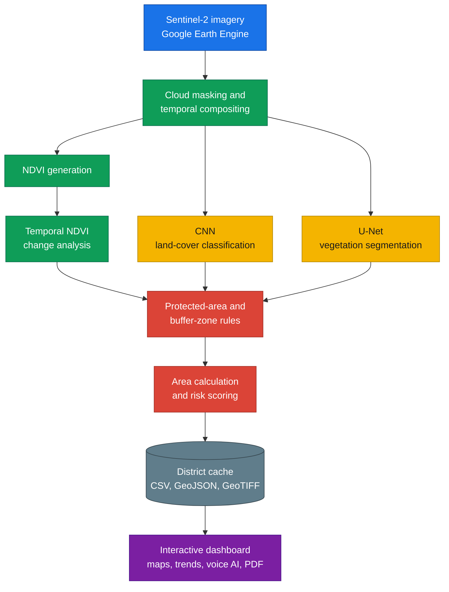

<div align="center">


<br>


</div>

---

## What is Geo Vision Plan-Net?

Cities spread, forests thin out and farmland gives way to concrete, yet no team can walk every hectare to see what has changed. **Geo Vision Plan-Net** does the watching from orbit, turning satellite imagery into evidence that planners, researchers and forest officials can act on.

It draws on **Sentinel-2 imagery** through **Google Earth Engine**, measures how vegetation has changed from year to year using **NDVI**, and adds two deep-learning models: a **CNN** that recognizes what kind of land a patch of ground is, and a **U-Net** that traces vegetation at the level of individual pixels. Spatial rules then check every detected change against protected areas and their buffer zones. The result is an interactive dashboard with district maps, multi-year trends, side-by-side comparisons, one-click PDF reports and a **voice assistant that answers in your own language**.

In short, it answers three questions for any district:

<div align="center">


</div>

> [!NOTE]
> **Design principle.** Every signal has its own job. NDVI gives the interpretable change signal, the CNN adds land-cover context, the U-Net draws fine vegetation boundaries, and the rule engine turns it all into screening evidence. No single model is asked to do everything.

---

## Key Features

| Capability | What it delivers |
|:---|:---|
| **Satellite data pipeline** | Cloud-masked Sentinel-2 composites processed on Google Earth Engine |
| **NDVI change detection** | Vegetation loss, gain and severe-loss masks between study periods |
| **CNN land-cover classification** | Ten-class patch classification with confidence scores (EuroSAT) |
| **U-Net segmentation** | Pixel-level vegetation masks from RGB imagery |
| **Rule-based risk screening** | Protected-area encroachment, 500 m buffer-zone violations and severe-loss flags |
| **Interactive GIS map** | Violation polygons and NDVI heatmap with dark and light themes |
| **Multi-year trends** | Loss, gain and flagged-violation analytics from 2017 to 2026 |
| **District comparison** | Any two districts, side by side, across every metric |
| **GeoAI voice assistant** | Voice and text queries in multiple Indian languages |
| **Automated reporting** | One-click PDF export of the executive summary |
| **Cache-driven speed** | Pre-computed district results for instant dashboard response |

---

## The Dashboard

Five tabs, one workflow: from the headline numbers down to individual violation polygons.

| Tab | What you see | Why it matters |
|:---|:---|:---|
| **Executive Overview** | Loss, gain, encroachment, buffer violations, severe loss, total flagged area, and a **risk level out of 100** with an auto-written summary | The whole district at a glance, ready to export as PDF |
| **GIS and NDVI Map** | Violation polygons on a Leaflet map beside an NDVI heatmap panel | Shows exactly where change happened and how intense it was |
| **Trend Analytics** | Vegetation loss versus gain per period, plus flagged violations per period | Reveals whether a district is recovering or deteriorating |
| **Compare Districts** | Two districts side by side on risk score, loss, gain, encroachment and flagged area | Helps prioritize where to act first |
| **AI Voice Assistant** | Voice or text questions answered in languages such as Telugu and Kannada | Makes the data accessible to field staff and officials in their own language |

Each district summary also carries recommended conservation actions, such as drone surveillance of eco-sensitive corridors, stop-work notices for illegal hill cutting and native afforestation along degraded riparian buffers.

---

## System Architecture

The workflow follows nine stages: region selection, satellite data acquisition and cloud masking, temporal compositing and NDVI generation, CNN land-cover classification, U-Net vegetation segmentation, temporal NDVI differencing, protected-area and buffer-zone overlay, rule-based risk screening with area calculation, and cache-driven GIS visualization and reporting.



<div align="center">


</div>

### Vegetation Change Detection

```
NDVI  = (NIR - Red) / (NIR + Red)
dNDVI = NDVI(t2) - NDVI(t1)
```

A negative change in NDVI means the vegetation signal dropped, and a positive change means it grew. Configurable thresholds turn the difference image into loss, gain and severe-loss masks, and affected area is reported in hectares.

### Default Analysis Parameters

| Parameter | Value | Description |
|:---|:---|:---|
| Satellite collection | `COPERNICUS/S2_SR_HARMONIZED` | Sentinel-2 surface reflectance |
| Maximum cloud cover | 20 % | Scenes above this are excluded |
| Loss threshold | dNDVI < -0.15 | Classified as vegetation loss |
| Gain threshold | dNDVI > +0.15 | Classified as vegetation gain |
| Severe-loss threshold | dNDVI < -0.30 | Triggers Rule C |
| Buffer distance | 500 m | No-encroachment zone around protected areas |
| Protected-area data | WDPA polygons | World Database on Protected Areas |

### Screening Rules

| Rule | Condition |
|:---|:---|
|  | Vegetation loss inside a protected area |
|  | Vegetation loss inside the 500 m buffer, outside the protected area |
|  | dNDVI below -0.30 anywhere in the region |

> [!IMPORTANT]
> The rule engine is a screening and decision-support component. It does not constitute legal adjudication.

---

## Deep Learning Models

<table>
<tr>
<td width="50%" valign="top">

### CNN: Land-Cover Classification

- **Input:** 64 x 64 x 3 RGB patches from the EuroSAT Sentinel-2 benchmark
- **Architecture:** four convolutional stages (32, 64, 128, 256 filters) with batch normalization and max-pooling, then global average pooling, a 128-unit dense layer, dropout of 0.4 and a ten-class softmax
- **Training:** Adam optimizer, sparse categorical cross-entropy, data augmentation
- **Role:** patch-level land-cover context and confidence

</td>
<td width="50%" valign="top">

### U-Net: Vegetation Segmentation

- **Input and output:** 128 x 128 x 3 RGB patches at 10 m, producing a per-pixel vegetation probability mask
- **Architecture:** encoder blocks (32, 64, 128 filters), a 256-filter bottleneck, a decoder with skip connections and a 1 x 1 sigmoid output
- **Training:** weakly supervised. Pixels with NDVI above 0.3 form the pseudo-labels, and the loss combines binary cross-entropy and Dice
- **Role:** pixel-level vegetation boundaries

</td>
</tr>
</table>

---

## Results

<div align="center">


</div>

### CNN on the EuroSAT Test Set (5,400 samples)

| Metric | Value |
|:---|:---|
| Test accuracy | **93.46 %** |
| Test loss | 0.1899 |
| Macro precision / recall / F1-score | 0.94 / 0.93 / 0.94 |

<details>
<summary><b>Class-wise performance (click to expand)</b></summary>

| Class | Precision | Recall | F1-score | Support |
|:---|:---:|:---:|:---:|:---:|
| Annual Crop | 0.99 | 0.89 | 0.93 | 596 |
| Forest | 0.97 | 0.99 | **0.98** | 608 |
| Herbaceous Vegetation | 0.92 | 0.90 | 0.91 | 573 |
| Highway | 0.96 | 0.92 | 0.94 | 496 |
| Industrial Buildings | 0.99 | 0.81 | 0.89 | 501 |
| Pasture | 0.94 | 0.96 | 0.95 | 396 |
| Permanent Crop | 0.91 | 0.94 | 0.92 | 538 |
| Residential Buildings | 0.88 | 1.00 | 0.93 | 554 |
| River | 0.91 | 0.96 | 0.94 | 529 |
| SeaLake | 0.99 | 0.97 | **0.98** | 609 |

</details>

### U-Net Vegetation Segmentation (Validation)

| Metric | Value |
|:---|:---|
| Dice coefficient | **0.9003** |
| Intersection over Union (IoU) | **0.8725** |
| Pixel accuracy | 0.9162 |

### Example District Outputs

| | Bengaluru Urban, Karnataka | Kamrup, Assam |
|:---|:---:|:---:|
| Study period | 2017 - 2026 | 2017 - 2026 |
| Vegetation loss | 23,386.3 ha | 27,914.2 ha |
| Vegetation gain | 29,945.9 ha | 40,013.1 ha |
| Total flagged violations | 6,694.6 ha | 5,849.9 ha |
| Risk score |  |  |

> [!WARNING]
> **Reading these results correctly.**
> The CNN accuracy is measured on the EuroSAT benchmark, so it shows strong patch-level recognition under benchmark conditions rather than proven performance in every region.
> The U-Net Dice and IoU measure agreement with NDVI-derived pseudo-labels, not independently annotated ground truth.
> The district outputs above are demonstration results.
> Planned work to address these points is listed under [Future Scope](#future-scope).

---

## Engineering Highlights

| Technique | Benefit |
|:---|:---|
| **Cache-first dashboard** | `build_cache.py` pre-computes every district once, so the live app never waits on Earth Engine |
| **Grid-cell statistics** | Large districts are split into cells of roughly 500 sq km, processed in parallel and summed, which keeps each request inside the Earth Engine time limit |
| **Adaptive GeoTIFF export** | The NDVI change map picks a resolution that fits the download limit, with automatic fallback to coarser scales |
| **Automatic retry** | Time-outs and memory errors are retried without manual intervention |

---

## Project Structure

```
geo-vision-plan-net/
├── server.py                  # Dashboard server (reads the cache only)
├── analysis_pipeline.py    # Earth Engine NDVI and rule-engine pipeline
├── build_cache.py          # Builds cache/<district>/ for every district
├── js/
│   └── map.js              # Leaflet GIS map renderer
├── cache/
│   └── <district_slug>/
│       ├── violation_summary.csv
│       ├── violation_trend.csv
│       ├── violation_zones.geojson
│       ├── ndvi_change_map.tif
│       └── metadata.json
└── requirements.txt
```

---

## Getting Started

<details open>
<summary><b>1. Clone and install</b></summary>

```bash
git clone https://github.com/<your-username>/geo-vision-plan-net.git
cd geo-vision-plan-net

python -m venv venv
venv\Scripts\activate          # Windows
# source venv/bin/activate     # macOS / Linux

pip install -r requirements.txt
```

</details>

<details open>
<summary><b>2. Authenticate with Google Earth Engine</b></summary>

```bash
earthengine authenticate
```

An Earth Engine-enabled Google Cloud project is required. Set the project ID where `build_cache.py` initializes Earth Engine.

</details>

<details open>
<summary><b>3. Build the district cache</b></summary>

```bash
python build_cache.py
```

This performs the Earth Engine analysis for each district and writes the results to `cache/`. It is the most time-consuming step.

</details>

<details open>
<summary><b>4. Launch the dashboard</b></summary>

```bash
python server.py
```

Open `http://localhost:8000` in a browser.

</details>

---

## Future Scope

| Direction | Plan |
|:---|:---|
| **Wider coverage** | Expand training and validation data across more Indian states, cities and ecological zones |
| **Independent validation** | Spatially independent test regions, cross-region studies and a human-annotated vegetation mask dataset |
| **Better pseudo-labels** | Multi-date NDVI composites, additional spectral indices and cloud-quality filtering |
| **Stronger temporal analysis** | Longer observation periods, consistent multi-year processing and segmentation at both temporal endpoints |
| **Advanced models** | Temporal deep-learning and change-detection architectures |
| **Richer risk rules** | Additional spatial datasets for sensitive ecological and planning zones |
| **Operational deployment** | Automated data updates, cloud deployment and emailed reports to authorized recipients |

---

## Institution

<div align="center">


-f4b400?style=for-the-badge)

</div>

**Sai Vidya Institute of Technology**, located at Rajanukunte, Bengaluru, is an engineering institution affiliated to Visvesvaraya Technological University (VTU), Belagavi. It emphasizes practical, project-based learning in technology and research. This work was carried out in the Department of Computer Science and Engineering (Artificial Intelligence and Machine Learning) as part of the BCI685 Project Phase 1 course.

---

## Team

| Name | Role |
|:---|:---|
| **Dr. T G Manjunath** |  DEAN ,Department of CSE (AI&ML) |
| **Anusha RV** |  |
| **Poornima P** |  |
| **Sohan Cholaraju** |  |
| **Manjunatha S** |  |

---

## Citation

```bibtex
@inproceedings{geovisionplannet2026,
  title       = {Geo Vision Plan-Net: Smart Green Cover Detection System},
  author      = {Manjunath, T G and Anusha, RV and Poornima, P and Cholaraju, Sohan and Manjunatha, S},
  institution = {Sai Vidya Institute of Technology, Bengaluru, India},
  year        = {2026}
}
```

## Acknowledgements

This work builds on the Copernicus Sentinel-2 mission, Google Earth Engine, the EuroSAT benchmark, the World Database on Protected Areas and the U-Net architecture of Ronneberger et al.

<div align="center">


</div>
